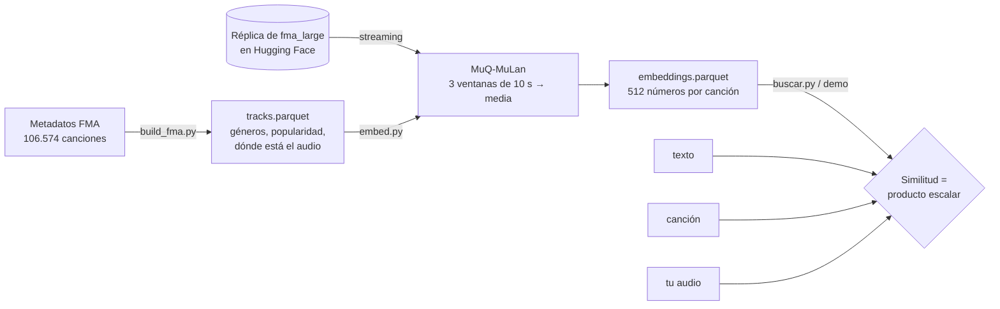

# Buscador de canciones parecidas

Convierte cada canción (un fragmento de 30 s) en un vector de 512 números con un modelo de IA y
busca las que suenan parecido. Como el modelo pone audio y texto en el mismo espacio, también se
puede buscar con una descripción: *"sad piano ballad"*, *"chill lo-fi hip hop beat"*.

- **Demo:** [huggingface.co/spaces/PGSCOM/buscador-musical](https://huggingface.co/spaces/PGSCOM/buscador-musical)
- **Datos:** [huggingface.co/datasets/PGSCOM/fma-muq-mulan](https://huggingface.co/datasets/PGSCOM/fma-muq-mulan)
  (105.000 canciones del Free Music Archive + sus embeddings)
- **Cómo funciona, explicado:** [BLOG.md](BLOG.md)

## Cómo funciona



1. **`build_fma.py`** baja los metadatos de FMA y genera `tracks.parquet`: una fila por canción
   con artista, escuchas, géneros finos, uno de 18 géneros grandes (`generos.py`) y su posición
   en la réplica del audio que hay en Hugging Face (no hace falta descargar los 93 GB).
2. **`embed.py`** lee cada clip en streaming, lo pasa por
   [MuQ-MuLan-large](https://huggingface.co/OpenMuQ/MuQ-MuLan-large) en ventanas de 10 s y guarda
   la media normalizada. En una RTX 4070 Ti SUPER va a unas 30 canciones/s (~1 h para todo FMA).
3. **`buscar.py`** (y la demo) compara vectores: el parecido entre dos canciones es su producto
   escalar. Para texto o audio nuevos, primero los pasa por el mismo modelo.
4. **`analizar.py`** resume cualquier `tracks*.parquet` (columnas, géneros, popularidad, décadas).

## Usarlo

```bash
python -m venv venv
venv/bin/pip install torch torchvision torchaudio --index-url https://download.pytorch.org/whl/cu128   # los 3 del mismo índice
venv/bin/pip install -r requirements.txt

# Buscar con los embeddings ya publicados (se descargan solos, ~220 MB)
venv/bin/python buscar.py --cancion "Jahzzar - Siesta"
venv/bin/python buscar.py --texto "acoustic folk guitar and female vocals"
venv/bin/python buscar.py --audio mi_cancion.mp3

# Reproducirlo todo desde cero
venv/bin/python build_fma.py                    # -> tracks.parquet (~2 min)
venv/bin/python embed.py tracks.parquet         # -> embeddings/part-*.parquet (GPU recomendada)
venv/bin/python analizar.py tracks.parquet
```

Cualquier otro catálogo con las mismas columnas (`track_id`, `preview_url` como URL de un MP3,
`macro_genre`, `genre_rank`…) funciona igual con `embed.py`, `buscar.py` y `analizar.py`.

## Licencias

- Código: MIT ([LICENSE](LICENSE)).
- Modelo MuQ-MuLan: pesos CC BY-NC 4.0, así que los embeddings y la demo son de **uso no comercial**.
- Metadatos de FMA: CC BY 4.0 (Defferrard et al., ISMIR 2017). Audio: la licencia CC de cada
  artista (columna `license`); aquí no se redistribuye, se lee de la réplica pública.
