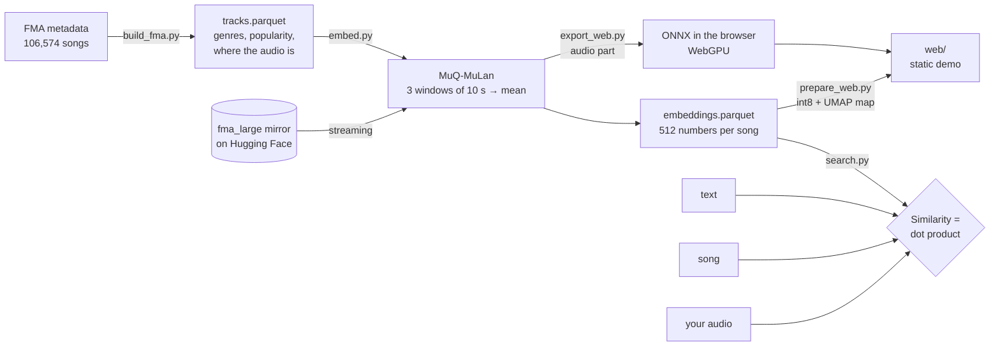

# Music similarity search

Turns every song (a 30 s clip) into a 512-number vector with an AI model and finds the ones that
sound alike. Because the model puts audio and text in the same space, you can also search with a
description: *"sad piano ballad"*, *"chill lo-fi hip hop beat"*.

- **Demo:** [huggingface.co/spaces/PGSCOM/MusicSearcher](https://huggingface.co/spaces/PGSCOM/MusicSearcher)
  (a static page: upload or record an audio file and the model runs in your browser with WebGPU)
- **Data:** [huggingface.co/datasets/PGSCOM/fma-muq-mulan](https://huggingface.co/datasets/PGSCOM/fma-muq-mulan)
  (106,574 songs from the Free Music Archive + their embeddings)
- **How it works, explained:** [BLOG.md](BLOG.md)
- **How to rebuild and publish it:** [PUBLISHING.md](PUBLISHING.md)

## How it works



1. **`build_fma.py`** downloads the FMA metadata and generates `tracks.parquet`: one row per song
   with artist, play count, fine genres, one of 18 macro genres (`genres.py`) and its position in
   the audio mirror hosted on Hugging Face (no need to download its 93 GB).
2. **`embed.py`** reads every clip in streaming, runs it through
   [MuQ-MuLan-large](https://huggingface.co/OpenMuQ/MuQ-MuLan-large) in 10 s windows and stores the
   normalized mean. On an RTX 4070 Ti SUPER it runs at about 30 songs/s (~1 h for all of FMA).
3. **`search.py`** (and the demo) compares vectors: the similarity between two songs is their dot
   product. For new text or audio, it first runs it through the same model.
4. **`web/`** is the demo: a page with no server. `prepare_web.py` turns the vectors into int8 (54 MB;
   the top-10 barely changes) and computes a 2D map with UMAP; `export_web.py` exports the audio
   part of the model to ONNX (spectrogram in fp32 + MuQ with 4-bit weights, 266 MB) so that your
   audio is processed in the browser. Text search stays in `search.py --text`.
5. **`analyze.py`** summarizes any `tracks*.parquet` (columns, genres, popularity, decades).

## Usage

```bash
python -m venv venv
venv/bin/pip install torch torchvision torchaudio --index-url https://download.pytorch.org/whl/cu128   # all 3 from the same index
venv/bin/pip install -r requirements.txt

# Search with the published embeddings (they download on their own, ~220 MB)
venv/bin/python search.py --song "Jahzzar - Siesta"
venv/bin/python search.py --text "acoustic folk guitar and female vocals"
venv/bin/python search.py --audio my_song.mp3

# Rebuild everything from scratch
venv/bin/python build_fma.py                    # -> tracks.parquet (~2 min)
venv/bin/python embed.py tracks.parquet         # -> embeddings/part-*.parquet (a GPU is recommended)
venv/bin/python analyze.py tracks.parquet

# Web demo
venv/bin/pip install umap-learn scikit-learn onnx onnxruntime onnx-ir
venv/bin/python prepare_web.py                  # -> web/emb.bin, web/map.bin, web/meta.json
venv/bin/python export_web.py web/model         # -> web/model/mel.onnx + audio_q4f16.onnx (on the machine with the GPU/RAM)
cd web && python -m http.server                 # http://localhost:8000
```

Any other catalogue with the same columns (`track_id`, `preview_url` pointing at an MP3,
`macro_genre`, `genre_rank`…) works the same with `embed.py`, `search.py` and `analyze.py`.

## License

- Code: MIT ([LICENSE](LICENSE)).
- MuQ-MuLan model: CC BY-NC 4.0 weights, so the embeddings and the demo are **non-commercial use
  only**.
- FMA metadata: CC BY 4.0 (Defferrard et al., ISMIR 2017). Audio: the CC license chosen by each
  artist (column `license`); it is not redistributed here, it is read from the public mirror.
